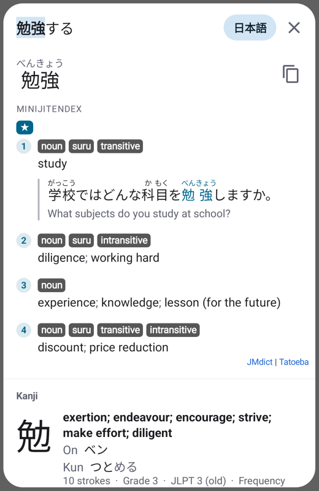
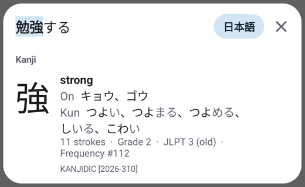

<h1 align="center">Shoten 書店</h1>

<p align="center">
  <b>A lightweight pop-up dictionary for Japanese and Chinese that works on top of any Android app.</b><br>
  Hold the home button, tap a word, read the definition.
</p>

<p align="center">
  <a href="https://github.com/ivoryprd/shoten/releases/latest"></a>
  <a href="https://github.com/ivoryprd/shoten/actions/workflows/build.yml"></a>
  
  
</p>

<p align="center">
  
  &nbsp;
  
</p>

Open Shoten with the assist gesture (holding the home button or the gesture handle, like Gemini or
Circle to Search on Pixel phones). The screen freezes, its text is recognized on-device, and tapping or
sliding over a word shows its dictionary entry.

## Features

- **Screen lookup (OCR)**: on-device text recognition with Google ML Kit (Japanese and Chinese models).
  Tap a character to look up the text from there, or slide your finger along a line to scan word by word.
  Words split by a line break are found across it, and vertical text (manga, vertical novels) is read
  column by column, which is far more reliable, even for small lettering and text on screentone. Misread characters can be corrected
  with a tap: Shoten suggests the characters that look like the one on the screen.
- **Yomitan-style lookups**: the longest matching word wins, Japanese conjugations are resolved
  (食べさせられなかった → 食べる, *causative › passive/potential › negative › past*), katakana and common
  OCR mistakes (コ一ヒ一 → コーヒー) are handled.
- **Dictionaries**: one-tap download of [Jitendex](https://jitendex.org) (modern Japanese–English
  dictionary based on JMdict) and [CC-CEDICT](https://cc-cedict.org) (Chinese–English, simplified and
  traditional headwords). Any **Yomitan dictionary** (.zip) can be imported: term dictionaries, frequency
  lists, pitch accents and kanji dictionaries. Jitendex's rich formatting (part-of-speech tags, example
  sentences, cross references, spelling tables, images) is rendered natively.
- **Also works without the assistant**: select text in any app and choose *Look up in Shoten*, share a
  screenshot or image to Shoten, or use the search box in the app.
- **Lightweight**: no AndroidX, no WebView, no Compose. The standard APK is about 1.2 MB; lookups take a
  few milliseconds; OCR models are released from memory a few minutes after use.

## Installing

Download the APK from the [latest release](https://github.com/ivoryprd/shoten/releases/latest) and open
it on your phone (allow installing apps from your browser or file manager when asked). There are two
variants:

| Variant | Size | OCR models |
| --- | --- | --- |
| `shoten-<version>.apk` (recommended) | ~1.2 MB | Downloaded by Google Play services on first use (needs Play services, as on every Pixel). |
| `shoten-<version>-offline.apk` | ~45 MB | Bundled in the APK. Works on devices without Google Play services. |

Newer releases install over older ones and keep your dictionaries. Only the latest release is kept.

## Setup

1. Open Shoten and tap **Get Jitendex** and/or **Get CC-CEDICT**. The download and import run in the
   background (Jitendex takes a few minutes to install and uses about 110 MB).
2. Tap **Choose Shoten as digital assistant** and select Shoten under *Digital assistant app*
   (Settings › Apps › Default apps › Digital assistant app).
3. In the same settings screen keep **Use text from screen** and **Use screenshot** turned on. Android
   only gives the assistant a screenshot when both are enabled.
4. Use the assist gesture in any app:
   - **Pixel phones:** long-pressing the handle/home button opens *Circle to Search* while that feature is on.
     Turn off *Hold handle for Circle to Search* (or *Hold Home for Circle to Search*) in
     Settings › System › Navigation mode, and the long press opens your digital assistant — Shoten.
   - Other options, depending on the device: swipe up diagonally from a bottom corner, or hold the power
     button when it is set to open the digital assistant.

Android does not let third-party apps replace *Circle to Search* itself; Shoten uses the official digital
assistant API, which is what the gesture falls back to once Circle to Search is turned off.

### Using the screen lookup

- Tap a character: the text from there on is looked up and the matched word is highlighted.
- Slide your finger along the text to scan continuously (handy in games).
- The result card slides up from the bottom (in landscape, on the side you didn't touch); if it would
  cover the selected text, the screenshot slides out of its way.
- Text that wraps onto the next line (or the next column of vertical text) is read as one, so words
  split by a line break are found.
- Tap a cross-reference inside a definition to look it up; back returns to the previous result.
- If a character was read wrong, tap it in the text at the top of the card (or tap ✎): Shoten suggests
  what it may be, comparing the character on the screen with every common kana and kanji (or hanzi),
  and puts the ones that make a dictionary word first (末来 → 未来). ⌫ deletes a stray character. The
  lookup, the highlight and *Copy all text* use the corrected text.
- The chip at the top switches between Japanese (日本語) and Chinese (中文) recognition. In automatic mode
  Shoten reads Japanese, and switches to Chinese when the screen has no kana and a Chinese dictionary is
  installed.
- Vertical text that ML Kit finds is read again column by column: the columns are found in the
  screenshot, cut into their characters' cells and read as horizontal lines, which ML Kit reads much
  more reliably than vertical text. Where the two readings differ, the character that looks more like
  the one on the screen is kept. The 縦 button (also in Settings) reads all text this way, for columns
  ML Kit doesn't recognize as vertical (small lettering, short columns in speech bubbles, screentone).
- Selection boxes are fitted to the characters in the screenshot: the boundaries between characters
  are placed in the gaps between them.
- Tap outside the text, press back, or use the assist gesture again to close.

Apps that block screenshots (banking apps, DRM-protected video) can't be read.

## Dictionaries

Dictionaries are managed under **Dictionaries**: enable/disable, reorder (higher dictionaries are shown
first), set the language, show attribution, and delete. Jitendex (and other dictionaries that publish
an update URL) and CC-CEDICT are checked for updates once a day when the screen is opened (the main
screen checks weekly and says when there are updates); **Update** or **Update all** installs them.

**Get KANJIDIC** installs [KANJIDIC](https://www.edrdg.org/wiki/index.php/KANJIDIC_Project) (over
10,000 kanji, from the [jmdict-yomitan](https://github.com/yomidevs/jmdict-yomitan) builds, which are
updated with it). Japanese lookups then also show the kanji of the word found: meanings, on and kun
readings (okurigana in gray), stroke count, school grade or jōyō/jinmeiyō, old JLPT level and frequency
rank. Tap a kanji in a headword to open just that kanji; back returns to the word.

More Yomitan dictionaries — frequency lists (JPDB, BCCWJ), pitch accents (Kanjium), other kanji
dictionaries, other bilingual dictionaries — are listed at
[MarvNC/yomitan-dictionaries](https://github.com/MarvNC/yomitan-dictionaries). Download the .zip and use
**Import a dictionary file**. See [docs/yomitan.md](docs/yomitan.md) for what is supported and what is
planned.

Each dictionary keeps its own license; Shoten shows the attribution included with it. Jitendex and
CC-CEDICT are licensed under CC BY-SA 4.0, KANJIDIC under CC BY-SA 4.0 (EDRDG).

## Privacy

Recognition and lookups happen entirely on the device; screenshots are never stored or uploaded. The
internet permission is only used to download dictionaries you choose (and, in the standard variant, Google
Play services downloads the OCR models).

## Building

Requirements: JDK 17 or newer and the Android SDK (Android Studio works out of the box).

```sh
./gradlew assembleStandardRelease   # app/build/outputs/apk/standard/release/
./gradlew assembleOfflineRelease    # bundled OCR models
./gradlew assembleDebug             # debug builds (installable next to release builds)
```

Release builds are minified with R8. To sign them with your own key, create `keystore.properties` in the
project root:

```properties
storeFile=/path/to/release.jks
storePassword=...
keyAlias=...
keyPassword=...
```

Without it, release builds are signed with the debug key. The offline variant can be limited to specific
ABIs to save space, e.g. `./gradlew assembleOfflineRelease -Pshoten.abiFilters=arm64-v8a`.

### Releases

Raising `versionName` in `app/build.gradle.kts` on the main branch publishes that version as a GitHub
release with signed APKs and deletes the older releases ([release.yml](.github/workflows/release.yml)).
It signs with the key in the repository secrets `SIGNING_KEYSTORE_BASE64`, `SIGNING_STORE_PASSWORD`,
`SIGNING_KEY_ALIAS` and `SIGNING_KEY_PASSWORD`; without them nothing is released.

### Tests

```sh
./gradlew testStandardDebugUnitTest lintStandardDebug
```

The unit tests cover the JSON parser, deinflection, lookups, importers, glossary compression, CSS
subset, OCR geometry, vertical text layout and character suggestions; Robolectric tests cover the
SQLite storage, rendering and the correction panel. Tests against the real
dictionaries run when `SHOTEN_TEST_DATA` points to a directory containing `jitendex-yomitan.zip` and
`cedict.zip` (they import all of Jitendex, check sentence lookups and render every tenth entry).

## How it works

```
assist gesture ─► ShotenAssistService (VoiceInteractionService)
                  └─► ShotenSession: transparent full-screen window, receives the screenshot
                      └─► ScreenLookupView: frozen screenshot + ML Kit OCR (OcrEngine)
                          └─► tap ─► LookupEngine (deinflection, longest match)
                                     └─► DictionaryRepository (one SQLite file per dictionary)
                                         └─► ResultPresenter / GlossaryRenderer ─► ResultsView
```

- `lookup/` — scanning, Japanese deinflection rules, furigana, pinyin. Pure Kotlin.
- `dict/importer/` — streaming Yomitan and CC-CEDICT importers (Jitendex's 466 MB of JSON never has to
  fit in memory). Pure Kotlin.
- `dict/` — SQLite storage. Glossaries are deflated with a preset dictionary trained on each
  dictionary's own entries (Jitendex: 466 MB of JSON → 109 MB database including indexes).
- `render/` — structured content to Android spans: ruby (furigana), tag chips, lists, tables, images
  and a small CSS subset so dictionary styles (e.g. Jitendex's colored tags) apply.
- `ocr/`, `overlay/`, `assist/`, `ui/` — Android parts. The tables of similar-looking characters for
  corrections (`app/src/main/assets/similar/`) are generated by `tools/similar_chars.py` from Jitendex
  and CC-CEDICT (see the script for how to run it).
